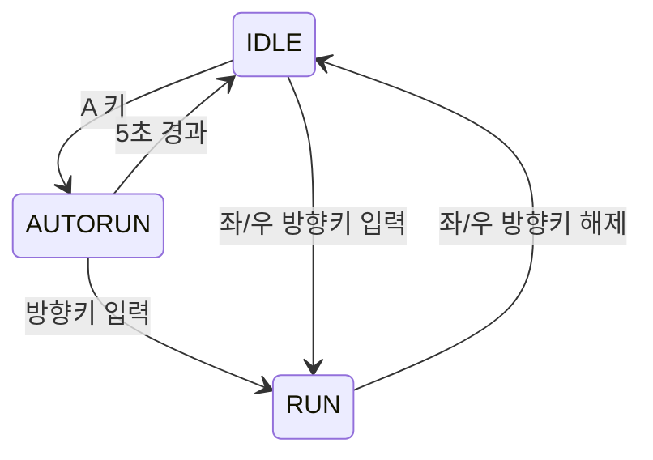

# PRD: Drill #1 — 소년 AutoRun 상태 추가

## 1. 개요

기존 2D 게임에 소년 캐릭터의 `AUTORUN` 동작을 추가한다. 플레이어는 `IDLE` 상태에서 `A` 키로 `AUTORUN`을 시작할 수 있다. `AUTORUN` 중 소년은 입력 없이 자동 이동하며, 5초가 지나거나 방향키를 누르면 다른 상태로 전환된다.

## 2. 목표

- `IDLE` 상태에서 `A` 키로 `AUTORUN`을 시작한다.
- `AUTORUN` 동안 소년이 입력 없이 좌우로 이동한다.
- `AUTORUN` 동안 일반 이동보다 빠르고 크게 표시한다.
- 화면 좌우 경계에 도달하면 이동 방향을 자동으로 바꾼다.
- `AUTORUN` 시작 후 5초가 지나면 `IDLE`로 돌아간다.
- `AUTORUN` 중 방향키를 누르면 이를 취소하고 일반 `RUN` 상태로 전환한다.

## 3. 상태 및 전이

좌/우 이동은 하나의 `RUN` 상태에서 처리하며, 방향에 따라 이동 방향만 달라진다. 방향키 입력으로 `RUN`에 진입하면 입력한 방향으로 일반 이동한다. `RUN` 상태에서 방향키를 해제하면 `IDLE`로 돌아간다. `AUTORUN`의 자동 방향 전환은 해당 상태 안에서 처리하며 별도 상태 전이로 취급하지 않는다.

## 4. 기능 요구사항

### FR-1. AutoRun 시작

- 현재 상태가 `IDLE`일 때 `A` 키를 누르면 `AUTORUN` 상태로 전환한다.
- `IDLE` 이외의 상태에서 `A` 키를 눌렀을 때의 동작은 본 요구사항 범위에 포함하지 않는다.

### FR-2. 자동 이동

- `AUTORUN` 상태에서는 방향키 입력 없이 캐릭터가 좌우로 계속 이동한다.
- `AUTORUN` 이동 속도는 일반 `RUN` 이동 속도보다 빨라야 한다.
- 화면의 좌우 경계에 닿으면 캐릭터가 화면 밖으로 나가지 않고 반대 방향으로 이동을 계속한다.

### FR-3. 크기 확대

- `AUTORUN` 상태의 캐릭터 표시 크기는 일반 상태보다 커야 한다.

### FR-4. 시간 만료

- `AUTORUN` 진입 시점부터 5초가 지나면 `IDLE` 상태로 전환한다.
- 전환 후 자동 이동 및 `AUTORUN` 전용 속도·크기 적용을 중단한다.

### FR-5. 방향키 입력 취소

- `AUTORUN` 상태에서 좌우 방향키를 누르면 이를 즉시 취소한다.
- 입력한 방향으로 이동하는 일반 `RUN` 상태로 전환한다.
- 전환 후 `AUTORUN` 전용 자동 방향 전환, 속도, 크기 적용을 중단한다.

### FR-6. 상태 머신 구현

- `IDLE`, `RUN`, `AUTORUN`은 모두 상태 머신으로 관리하고 상태 전이에 따라 동작해야 한다.
- `AUTORUN` 동작은 다른 상태와 구분되는 별도의 `AutoRun` 상태 클래스로 구현한다.
- `A` 키 입력, 방향키 입력·해제, 5초 경과 조건은 상태 머신의 전이로 처리한다.

### FR-7. 일반 RUN 상태

- 좌·우 방향키 입력 시 공통 `RUN` 상태로 전환한다. 좌우별 별도 상태는 두지 않는다.
- `RUN` 상태에서는 눌린 방향키에 따라 캐릭터가 일반 속도로 이동한다.
- 방향키 입력을 해제하면 `IDLE` 상태로 전환한다.

## 5. 지정 리소스

- 애니메이션 이미지: `Animation_sheet.png`

## 6. 완료 기준

1. `IDLE`에서 `A` 키를 누르면 `AUTORUN`이 시작된다.
2. `AUTORUN` 시작 후 5초가 지나면 `IDLE`로 복귀한다.
3. `AUTORUN` 중 캐릭터 이동 속도가 일반 `RUN`보다 빠르다.
4. `AUTORUN` 중 캐릭터 표시 크기가 일반 상태보다 크다.
5. `AUTORUN` 중 화면 좌우 경계에서 이동 방향이 자동으로 바뀐다.
6. `AUTORUN` 중 방향키 입력 시 입력 방향의 일반 `RUN`으로 전환한다.
7. 상태 흐름이 이 문서의 상태 다이어그램과 일치한다.
8. `IDLE`, `RUN`, `AUTORUN`의 진입·동작·전이가 상태 머신으로 관리된다.
9. `AUTORUN`이 별도 상태 클래스로 구현되어 있다.
10. 좌·우 방향키가 같은 `RUN` 상태를 사용하고, 방향키 해제 시 `IDLE`로 돌아간다.

## 7. 개발 및 변경 관리

- 게임 개발 라이브러리로 `pico2d`를 사용한다.
- 개발은 Git으로 관리하고, 변경 단위가 명확하도록 커밋을 나눈다.
- 전체 커밋 수는 대략 15~20개 이내를 목표로 한다.
- 개발 중 요구사항·동작·완료 기준이 바뀌면 구현과 함께 이 PRD도 갱신한다.
- 갱신된 PRD와 실제 구현 사이에 불일치가 남지 않도록 유지한다.
